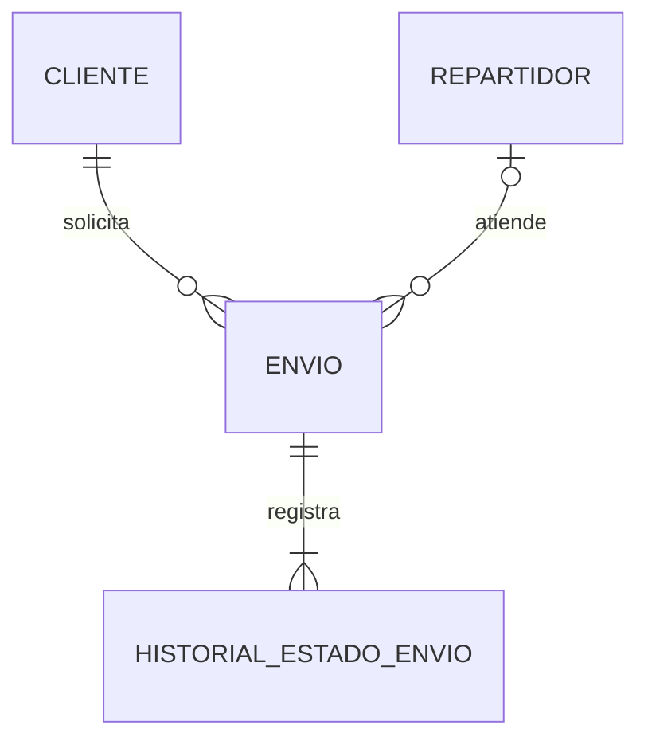

# shipment-service — LogiTrack Atom

Microservicio del Sprint 01 de Desarrollo y Arquitectura Avanzada de Software.
Permite registrar envíos, generar su tracking, asignar repartidores y consultar
estados e historial. Es el núcleo logístico de LogiTrack; este sprint no implementa
un marketplace completo, pagos, facturación ni cálculo de tarifas.

## Alcance académico y versiones

La consigna original menciona Spring Boot 3.x y JUnit 5. El equipo sigue la
aclaración docente de usar Boot 4.x y excluir tarifas (incluidas sus pruebas).
El proyecto usa la API `org.junit.jupiter` con **Jupiter 6.0.3**, administrada por
el BOM de Boot; no se fuerza JUnit 5 ni se presenta 6.x como si fuera 5.x.
La aceptación docente de esta diferencia de JUnit no tiene confirmación registrada
y debe explicitarse al preparar la entrega.

| Componente | Versión del proyecto o verificada |
| --- | --- |
| Java | 25; ejecución verificada con OpenJDK 25.0.4.1 |
| Spring Boot | 4.1.1 |
| Maven Wrapper / Maven | 3.3.4 / 3.10.0 |
| JUnit Jupiter / Mockito | 6.0.3 / 5.23.0, gestionados por Boot |
| MySQL | imagen `mysql:8.4`; pruebas con servidor 8.4.11 |
| springdoc-openapi | 3.0.2 |
| Testcontainers / Failsafe | 2.0.5 / 3.5.6 |
| Docker / Compose usados | Engine 29.8.0 / Compose 5.5.1 |
| Postman por terminal (opcional) | Newman 6.2.3, probado con Node.js 24.15.0 |

No hace falta instalar Java, Maven o Node en el host para levantar la aplicación
con Docker. Java 25 se necesita para Maven local; Node solo para Newman.

## Primer arranque con Docker Compose

Desde un checkout de `develop` (o de la rama que se quiera verificar):

```sh
git clone --branch develop https://github.com/LogiTrack-Atom/shipment-service.git
cd shipment-service
if [ ! -f .env ]; then cp .env.example .env; fi
# Completar MYSQL_PASSWORD y MYSQL_ROOT_PASSWORD en .env con valores locales.
docker info
docker compose up --build -d
docker compose ps
docker compose logs -f shipment-service
```

Esperar el arranque de Spring. `Ctrl+C` sale del seguimiento de logs; no detiene
los contenedores. Con los puertos predeterminados:

- API: <http://localhost:8080/api/v1/envios>.
- Swagger UI: <http://localhost:8080/swagger-ui/index.html>.
- OpenAPI JSON: <http://localhost:8080/v3/api-docs>.
- MySQL para Workbench/cliente local: `localhost:3307`.

`.env.example` contiene marcadores, no credenciales para compartir. `.env` queda
ignorado por Git y por el contexto de construcción de Docker.

| Variable de Compose | Valor de ejemplo / significado |
| --- | --- |
| `MYSQL_DATABASE` | `shipment_db`, base inicial |
| `MYSQL_USER` | `shipment_user`, usuario de la aplicación |
| `MYSQL_PASSWORD` | Elegir localmente; no versionar el valor real |
| `MYSQL_ROOT_PASSWORD` | Elegir localmente; solo administración/inicialización |
| `MYSQL_HOST_PORT` | `3307`, puerto SQL publicado en el host |
| `APP_PORT` | `8080`, puerto HTTP publicado en el host |
| `JPA_DDL_AUTO` | `validate`, verifica el esquema SQL sin modificarlo |
| `TZ` | `UTC` |

Si se cambian los puertos, ajustar también Postman y Workbench. El valor `0`
permite que Docker asigne un puerto libre; consultarlo con:

```sh
docker compose port shipment-service 8080
docker compose port mysql 3306
```

Dentro de Compose la aplicación se conecta a `mysql:3306`, no a `localhost:3307`.
Los nombres de contenedor `shipment-service` y `shipment-mysql` son fijos: dos
instancias simultáneas necesitan además nombres distintos mediante un override.

### Parada, reinicio y reconstrucción

```sh
docker compose stop
docker compose start
# Después de cambiar código o variables de la aplicación:
docker compose up -d --build shipment-service
# Retirar los contenedores y la red conservando el volumen de MySQL:
docker compose down
```

`restart` no aplica cambios del archivo `.env`; usar `up` para recrear el servicio
afectado. No eliminar el volumen del equipo para comprobar el SQL inicial.

### Ejecución local o desde IntelliJ

Primero levantar solo MySQL con `docker compose up -d mysql`. Compose lee `.env`,
pero Java, IntelliJ y Maven **no lo cargan automáticamente**. Configurar las
variables `DB_URL`, `DB_USERNAME`, `DB_PASSWORD` y `JPA_DDL_AUTO` en la ejecución
de la IDE, o pasarlas al proceso desde la terminal:

```sh
DB_URL='jdbc:mysql://localhost:3307/shipment_db?useSSL=false&allowPublicKeyRetrieval=true&serverTimezone=UTC' \
DB_USERNAME=shipment_user DB_PASSWORD='<contraseña local de MYSQL_USER>' \
JPA_DDL_AUTO=validate sh ./mvnw spring-boot:run
```

La URL debe usar el puerto y nombre de base elegidos en `.env`. La aplicación
usa el usuario de negocio, no `root`. Para evitar un conflicto en 8080, no
ejecutar simultáneamente la aplicación local y el servicio HTTP de Compose.

## Arquitectura y modelo de dominio

Los controllers exponen HTTP y validan DTO; los servicios aplican las reglas en
transacciones; los repositories usan Spring Data JPA. Los mappers transforman
DTO/entidades. `GlobalExceptionHandler` unifica errores con `ApiError`.
`open-in-view=false` evita depender de una sesión JPA abierta durante la respuesta.



Hay cuatro tablas. `Direccion` está embebida dos veces en Envio (origen/destino);
`BaseEntity` aporta UUID y auditoría, sin crear una quinta tabla. El servicio
genera el tracking y el evento inicial del envío. El modelo no incluye tarifa.

- Registro: crea un envío `PENDIENTE` y su historial inicial atómicamente.
- Cliente: se busca por email; si existe se conserva su UUID y sus datos, aunque
  la nueva solicitud traiga un nombre o teléfono distinto. No se sobrescribe.
  La comparación usa la colación de MySQL; no hay una normalización adicional.
- Asignación: solo un envío `PENDIENTE` admite un repartidor `ACTIVO`. Asignar o
  reemplazar repartidor no cambia el estado ni agrega un evento de estados.
- Transiciones: `PENDIENTE → EN_RUTA/CANCELADO`; `EN_RUTA → ENTREGADO`.
  `EN_RUTA` exige repartidor asignado activo. `ENTREGADO` y `CANCELADO` son terminales.
  Repetir un estado o una cancelación se rechaza.
- Historial: eventos por `fechaCambio` ascendente; no se promete un orden entre
  fechas idénticas. Si falla su escritura, se revierte la operación completa.
- Medidas positivas: kg con hasta 7 enteros/3 decimales, cm con 8 enteros/2 decimales.
  Mínimos: `0.001 kg` y `0.01 cm`; máximos: `9999999.999 kg` y `99999999.99 cm`.
  Una escala o rango no representable devuelve 400 antes de guardar.

## API y errores

Los cuerpos y respuestas usan JSON; los identificadores HTTP son UUID de texto.
Las listas no prometen un orden específico. No se publican entidades JPA.

| Método | Ruta | Operación |
| --- | --- | --- |
| POST | `/api/v1/envios` | Registrar; responde 201 |
| GET | `/api/v1/envios?estado=ENTREGADO` | Listar; filtro opcional |
| GET | `/api/v1/envios/{id}` | Consultar por UUID |
| GET | `/api/v1/envios/seguimiento/{codigoSeguimiento}` | Consultar por tracking |
| GET | `/api/v1/envios/{id}/historial` | Historial de estados |
| PUT | `/api/v1/envios/{id}/repartidor` | Asignar con `repartidorId` |
| PATCH | `/api/v1/envios/{id}/estado` | Cambiar con `estado` |
| PATCH | `/api/v1/envios/{id}/cancelacion` | Cancelar un pendiente |
| POST | `/api/v1/repartidores` | Registrar ACTIVO; responde 201 |
| GET | `/api/v1/repartidores?estado=ACTIVO` | Listar; filtro opcional |
| GET | `/api/v1/repartidores/{id}` | Consultar por UUID |

Ejemplo válido de registro:

```json
{
  "cliente": {"nombre": "Ana Demo", "email": "ana@example.test", "telefono": "+5493880000000"},
  "origen": {"calle": "Belgrano", "numero": "100", "ciudad": "Jujuy", "codigoPostal": "Y4600"},
  "destino": {"calle": "Alvear", "numero": "200", "ciudad": "Salta", "codigoPostal": "A4400"},
  "pesoKg": 1.250,
  "anchoCm": 25.25,
  "altoCm": 15.50,
  "largoCm": 30.75
}
```

`ApiError` contiene `timestamp`, `status`, `error`, `mensaje` y `detalles`.
Los ejemplos y esquemas completos están en Swagger/OpenAPI.

| Código | Caso real |
| --- | --- |
| 400 | JSON, UUID o enum inválido; datos obligatorios ausentes; medidas no representables |
| 404 | Envío, repartidor o tracking inexistente |
| 422 | Transición, cancelación o asignación contraria a las reglas |
| 409 | Restricción de integridad/longitud/unicidad de MySQL; no significa automáticamente email repetido |

## Postman y Newman

Importar ambos archivos y seleccionar el entorno **LogiTrack Atom — Local (ejemplo)**:

- [Colección Sprint 01](postman/LogiTrack-Sprint01.postman_collection.json).
- [Entorno local de ejemplo](postman/LogiTrack-Local.postman_environment.json).

Cambiar únicamente `baseUrl` si la API no está en `http://localhost:8080`.
Ejecutar la **colección completa en orden** mediante Collection Runner:

| Carpeta | Solicitudes | Propósito |
| --- | ---: | --- |
| 00 — Preparación | 1 | Comprobar API, regenerar email/runId y limpiar variables anteriores |
| 01 — Entrega completa | 12 | Crear, consultar, asignar, EN_RUTA, ENTREGADO e historial |
| 02 — Cancelación y reutilización de Cliente | 4 | Otro envío con el mismo Cliente, medidas mínimas y cancelación independiente |
| 03 — Errores esperados | 19 | Regresión decimal y respuestas 400/404/422/409 |

Los scripts capturan `envioId`, `tracking`, `clienteId`, `repartidorId`,
`cancelacionId` y `cancelacionTracking` de respuestas reales. `runId` y
`clienteEmail` se generan por ejecución. No hay que copiar UUID manualmente.
Para repetir la demo, volver a ejecutar desde 00; no empezar por carpetas que
dependen de variables aún vacías. Los errores de 03 son resultados esperados:
solo hay fallo cuando la respuesta no cumple sus aserciones.

Cada ejecución crea 1 cliente, 2 envíos, 1 repartidor y 5 eventos de historial.
Los envíos terminan ENTREGADO y CANCELADO. Se conservan los datos de demostración;
la API no ofrece DELETE. El entorno versionado contiene ejemplos, sin secretos
ni identificadores de una ejecución previa.

Opcionalmente, con Node.js, ejecutar lo mismo desde la terminal:

```sh
npx --yes --package=newman@6.2.3 newman run postman/LogiTrack-Sprint01.postman_collection.json \
  -e postman/LogiTrack-Local.postman_environment.json --bail
```

Se puede ajustar el puerto sin editar archivos agregando
`--env-var baseUrl=http://localhost:PUERTO`. Newman comprueba las solicitudes y
sus aserciones; no reemplaza las pruebas transaccionales de Maven.

## Pruebas del proyecto

Desde la raíz, con Java 25:

```sh
# Unitarias/web aisladas con Surefire: sin Docker ni MySQL.
sh ./mvnw test
# Suite completa: Surefire + integraciones *IT con Failsafe y MySQL temporal.
sh ./mvnw clean verify
```

Para `verify`, Docker debe estar disponible y poder obtener `mysql:8.4` y Ryuk.
No hace falta Compose, `.env` ni credenciales de desarrollo. Testcontainers inicia
una base `shipment_test` aislada con puerto aleatorio, copia el SQL versionado de
#9 al entrypoint y usa `ddl-auto=validate`. Las propiedades dinámicas sustituyen
la conexión externa; no se reutilizan contenedores/volúmenes del equipo.
Si Docker no está disponible, las integraciones fallan y no se omiten silenciosamente.

Las IT corren secuencialmente y limpian únicamente esa base, respetando las FKs.
No tienen `@Transactional` general: los servicios hacen commits reales. Ryuk
retira sus recursos al terminar.

| Suite | Qué comprueba |
| --- | --- |
| `EnvioMedidasValidationTest` | Frontera HTTP y Bean Validation sin base de datos |
| `ShipmentPersistenceIT` | UUID/auditoría/relaciones/direcciones tras flush-clear, búsquedas, unicidad, FKs e historial ordenado |
| `ShipmentApiIT` | Flujo persistente, precisión y respuestas 400/404/422/409 con Spring/MockMvc y MySQL reales |
| `ShipmentTransactionIT` | Error real 1644/45000 al guardar historial y comprobación del rollback en otra transacción |
| `OpenApiIT` | 11 operaciones, 12 ejemplos cotejados con errores reales, esquemas y recursos de Swagger UI |
| `BusinessLogIT` | Logs de éxito solo después de commit, sin datos de las solicitudes |

La base integrada de #11 tiene **84 pruebas aprobadas: 28 unitarias y 56 IT**,
sin fallos, errores ni omitidas. No es un porcentaje de cobertura; las unitarias
del core de [#7](https://github.com/LogiTrack-Atom/shipment-service/issues/7) siguen
su propio seguimiento. Los reportes están en `target/surefire-reports` y
`target/failsafe-reports`; el resultado de cada entrega queda en su PR.
`sh ./mvnw -Dit.test=ShipmentTransactionIT verify` sirve para diagnóstico, pero
una selección de pruebas no sustituye `clean verify`.

## SQL, almacenamiento y Workbench

`docker/mysql/init/001-schema.sql` define las cuatro tablas InnoDB, UUID BINARY(16),
auditoría DATETIME(6), estados ENUM, medidas DECIMAL(10,3)/(10,2), dos unicidades
de negocio y tres FKs sin borrado en cascada. UUID y auditoría los genera la aplicación.
La colación `utf8mb4_0900_ai_ci` compara texto ignorando mayúsculas y acentos.

MySQL ejecuta el SQL montado en `/docker-entrypoint-initdb.d` **solo al inicializar
almacenamiento nuevo**, sobre `MYSQL_DATABASE`. Reiniciar con un volumen existente
no repite el script. Hibernate usa `validate`: no crea, actualiza ni borra tablas.
Si una base anterior se creó con `update`, respaldarla y comparar el esquema antes
de una migración explícita; no activar `update/create` para ocultar diferencias.

Workbench se conecta por TCP a `127.0.0.1`, puerto `MYSQL_HOST_PORT`, con
`MYSQL_USER`/`MYSQL_PASSWORD` y la base `MYSQL_DATABASE`. Postman se conecta por
HTTP a la API, que persiste en esa MySQL. **Postman y Workbench no se conectan entre sí**.

También se puede abrir el cliente SQL del contenedor; pide la contraseña del usuario:

```sh
docker compose exec mysql sh -c 'exec mysql -u"$MYSQL_USER" -p "$MYSQL_DATABASE"'
```

```sql
SHOW TABLES;
SHOW CREATE TABLE envios;
SELECT BIN_TO_UUID(id) AS id, codigo_seguimiento, estado, peso_kg FROM envios;
SELECT estado_anterior, estado_nuevo, fecha_cambio FROM historial_estados_envio ORDER BY fecha_cambio;
```

## Contratos Java y logs

`ShipmentService` y `RepartidorService` documentan precondiciones, excepciones y
efectos transaccionales. `BusinessLog` emite INFO tras commit para registro,
asignación y cambio de estado, con UUID/enums capturados sin entidades JPA.
Un rollback no imprime un éxito. Los servicios usan WARN para reglas rechazadas
y DEBUG para consultas por estado. Los nuevos logs de negocio no vuelcan cuerpos,
nombres, emails, teléfonos, direcciones ni credenciales.

Para habilitar las consultas DEBUG sin activar SQL ni cuerpos HTTP, pasar
`LOGGING_LEVEL_COM_LOGITRACK_ATOM_SHIPMENT_SERVICE_SERVICE_IMPL=DEBUG` a Java/IDE.
Compose no reenvía automáticamente variables arbitrarias del host o `.env`:
para el contenedor hay que declararla explícitamente en `environment` mediante
un override local. Ver los logs con `docker compose logs -f shipment-service`.

## Trazabilidad y estado del sprint

[Milestone Sprint 01](https://github.com/LogiTrack-Atom/shipment-service/milestone/1).
Se registra quién publicó cada aporte, sin atribuir como propio el código previo.

| Aporte | Autor de la PR | Seguimiento | PR integrada |
| --- | --- | --- | --- |
| Proyecto inicial | DiazGab | [#1](https://github.com/LogiTrack-Atom/shipment-service/issues/1) | [#3](https://github.com/LogiTrack-Atom/shipment-service/pull/3) |
| Core de entidades, servicios y API | DiazGab | [#6](https://github.com/LogiTrack-Atom/shipment-service/issues/6) | [#4](https://github.com/LogiTrack-Atom/shipment-service/pull/4) |
| Docker y MySQL | DiazGab | [#2](https://github.com/LogiTrack-Atom/shipment-service/issues/2) | [#5](https://github.com/LogiTrack-Atom/shipment-service/pull/5) |
| Precisión de medidas | MaxDZ-10 | [#8](https://github.com/LogiTrack-Atom/shipment-service/issues/8) | [#15](https://github.com/LogiTrack-Atom/shipment-service/pull/15) |
| SQL inicial y estrategia validate | MaxDZ-10 | [#9](https://github.com/LogiTrack-Atom/shipment-service/issues/9) | [#16](https://github.com/LogiTrack-Atom/shipment-service/pull/16) |
| Integración, API y rollback | MaxDZ-10 | [#10](https://github.com/LogiTrack-Atom/shipment-service/issues/10) | [#17](https://github.com/LogiTrack-Atom/shipment-service/pull/17) |
| OpenAPI, contratos y logs | MaxDZ-10 | [#11](https://github.com/LogiTrack-Atom/shipment-service/issues/11) | [#18](https://github.com/LogiTrack-Atom/shipment-service/pull/18) |

Esta guía y Postman se entregan mediante [#12](https://github.com/LogiTrack-Atom/shipment-service/issues/12).
La reproducción desde checkout limpio se verifica con los comandos anteriores;
el commit, entorno y resultados se registran en la PR enlazada desde la issue.
JMatiasF continúa las unitarias del core en
[#7](https://github.com/LogiTrack-Atom/shipment-service/issues/7).
La revisión final, grabación y entrega siguen en
[#13](https://github.com/LogiTrack-Atom/shipment-service/issues/13).

## Problemas frecuentes

| Síntoma | Comprobación |
| --- | --- |
| No conecta con Docker | Abrir/iniciar Docker y comprobar `docker info` |
| Puerto o nombre ocupado | Revisar `docker compose ps`, puertos locales y los nombres fijos; ajustar el entorno sin borrar datos |
| Java no recibe credenciales | Configurar `DB_*` en el proceso/IDE; no basta con editar `.env` |
| Hibernate informa tabla/columna faltante | Comparar base y SQL; un volumen existente no ejecuta otra vez el init |
| Postman usa UUID vacío | Seleccionar el entorno y ejecutar toda la colección desde 00 |
| La colección muestra HTTP 400/404/422/409 | Revisar sus aserciones: en la carpeta 03 esos códigos son esperados |

Referencias técnicas: [MySQL oficial](https://hub.docker.com/_/mysql),
[Testcontainers MySQL](https://java.testcontainers.org/modules/databases/mysql/),
[Maven Failsafe](https://maven.apache.org/surefire/maven-failsafe-plugin/)
y [Newman](https://learning.postman.com/docs/reference/newman-cli/installing-running-newman).
