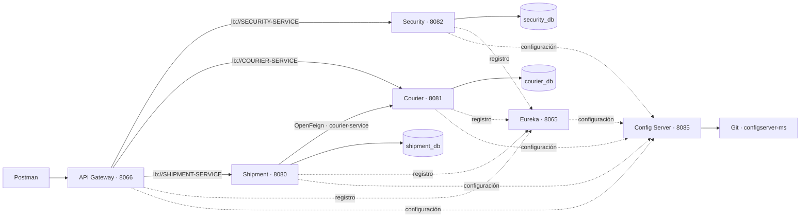

# Arquitectura y operación de Sprint03

## Componentes

Son seis aplicaciones Spring Boot y tres MySQL. El repositorio configserver-ms aporta
archivos Git; no es otra aplicación ni requiere contenedor. Config Server no se registra
en Eureka. Eureka autónomo no se autorregistra y no transporta las llamadas de negocio.

Las APIs externas ingresan por Gateway. Eureka publica las instancias y LoadBalancer
selecciona el destino; Shipment consulta disponibilidad mediante Feign. Cada dominio
conserva sus tablas, usuario y volumen. No hay relaciones JPA ni consultas SQL entre bases.

| Prefijo público | Destino | Transformación |
| --- | --- | --- |
| /applications/apisecurity/** | lb://SECURITY-SERVICE | StripPrefix=2 |
| /applications/apicourier/** | lb://COURIER-SERVICE | StripPrefix=2 |
| /applications/apishipment/** | lb://SHIPMENT-SERVICE | StripPrefix=2 |

Por ejemplo `/applications/apishipment/api/v1/envios` llega como `/api/v1/envios`.
Los puertos internos, nombres y criterios completos se mantienen en
[Contratos_tecnicos.md](Contratos_tecnicos.md).

## Seguridad

Security registra CLIENTE, administra cuentas con ADMIN y emite JWT RS256 con duración
de 15 minutos. La clave privada solo se monta en Security. Gateway y los dominios usan
la misma clave pública externa y validan firma, issuer, audience, tiempos y roles.

Gateway autoriza método, ruta y rol. Los servicios vuelven a validar el token y resuelven
pertenencia de recursos: un CLIENTE no lee envíos ajenos y un REPARTIDOR opera solamente
los envíos asociados a su identidad. Las cabeceras de identidad no reemplazan un JWT
válido. No hay introspección HTTP a Security por cada solicitud.

| Operación | Permiso |
| --- | --- |
| Login y registro público | Anónimo; registro crea CLIENTE |
| Crear envío | ADMIN o CLIENTE |
| Asignar repartidor | ADMIN, envío PENDIENTE |
| EN_RUTA / ENTREGADO | ADMIN o REPARTIDOR con pertenencia |
| Leer envío e historial | Rol conocido y pertenencia en Shipment |
| Administrar repartidores, usuarios y asociaciones | ADMIN |
| Diagnóstico de configuración de Courier | ADMIN |

El alcance obligatorio es de APIs. CORS figura como deseable; no se habilitan orígenes
globales para un frontend que no forma parte de esta entrega.

## Caso crítico de asignación

1. ADMIN inicia sesión por `/applications/apisecurity/api/v1/auth/login`.
2. Crea o selecciona un repartidor ACTIVO y un envío PENDIENTE.
3. Invoca `PUT /applications/apishipment/api/v1/envios/{id}/repartidor` con `repartidorId`.
4. Gateway valida JWT y rol. Shipment comprueba sus reglas de negocio y consulta
   `GET /api/v1/repartidores/{id}/disponibilidad` mediante Feign.
5. Eureka permite resolver el nombre; LoadBalancer elige la instancia de Courier.
6. Shipment valida UUID, estado y disponibilidad de la respuesta antes de persistir.
7. La lectura posterior conserva la asignación y el estado PENDIENTE. Asignar no crea
   otro evento de historial de estados.
8. Al pasar a EN_RUTA se vuelve a comprobar disponibilidad; ENTREGADO completa el flujo.

ACTIVO significa disponible, no reservado ni exclusivo. No se inventa una transacción
distribuida o una restricción de un único envío por repartidor.

| Resultado de la consulta | Respuesta de Shipment |
| --- | --- |
| UUID/estado/disponibilidad coherentes | Continúa la operación local |
| Repartidor inexistente | 404 |
| Repartidor INACTIVO o regla de negocio inválida | 422 |
| Timeout, conexión rechazada, ausencia de instancia, 429 o 5xx | 503 |
| Contrato malformado o respuesta HTTP inesperada | 502 |

ErrorDecoder clasifica respuestas HTTP. El adaptador Feign clasifica fallos de transporte.
Los rechazos mantienen asignación, estado, fechas e historial. No hay un fallback que
considere disponible a un repartidor cuyo estado no se pudo comprobar ni reintentos
multiplicados que repitan la operación.

## Operación y evidencia

El arranque sigue Config → Eureka → dominio → Gateway. `depends_on` y healthchecks
ordenan la creación; la demo espera además que Gateway alcance las tres APIs después
de la propagación de Eureka. Registro y salud por sí solos no prueban que las cachés
de los clientes ya estén actualizadas.

Usar el manifiesto de [entrega/versiones.json](entrega/versiones.json) y la guía
[Demo_Sprint03.md](Demo_Sprint03.md) para preparar, ejecutar Postman y restablecer la
demo. Las claves, contraseñas y entornos de Postman se generan fuera de Git.

La configuración se verifica de dos formas: matriz HTTP de Config Server con revisión
Git y perfiles, y consumo en el cliente mediante pruebas de arranque/beans y diagnóstico
ADMIN. `/api/v1/admin/configuracion` solo devuelve aplicación, perfiles y marcador;
no se habilitan `/actuator/env` ni `/actuator/configprops`.

La entrega conserva las fuentes históricas de Sprint02. La nueva evidencia se registra
con fecha, referencias y límites; no se presentan resultados antiguos como una ejecución
del código actual. Las suites Java cubren además 500/timeout y respuestas malformadas
con HTTP real y MySQL, aunque esos escenarios no se provoquen en el Courier de negocio.

## Deuda técnica y entrega académica

Se preparan el flujo completo y sus rechazos en Postman, los datos reproducibles y el
diagnóstico de configuración reclamados en la revisión anterior. Tarifas sigue siendo
una responsabilidad mencionada sin fórmula, moneda o contrato definidos por la cátedra;
no se afirma que exista una funcionalidad de cálculo de tarifas.

La participación de los tres integrantes, el ensayo conjunto, la grabación y la entrega
académica requieren evidencia propia. El guion y las pruebas técnicas permiten prepararlos;
no sustituyen esa participación ni autorizan marcar un video como entregado.
